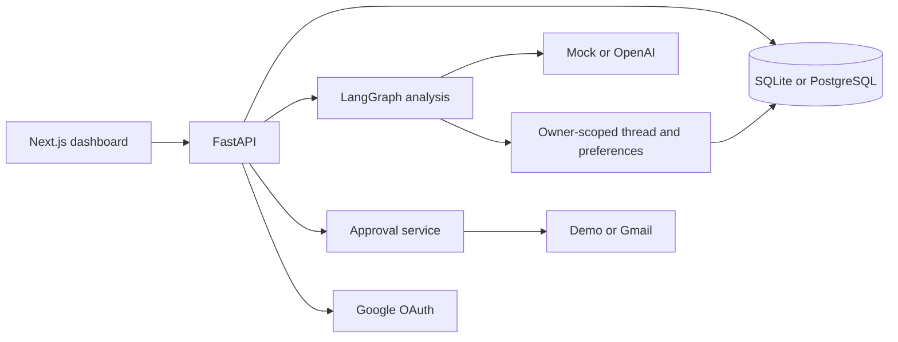

# InboxPilot AI

InboxPilot turns email into prioritized work. It summarizes messages, extracts tasks and suggested follow-ups, drafts replies, and records each approval decision. The demo uses 24 synthetic messages and a deterministic local classifier.

## Run locally

With Docker Compose v2.24 or newer:

```sh
docker compose up --build
```

The frontend is at [localhost:3000](http://localhost:3000), the API is at [localhost:8000/docs](http://localhost:8000/docs), and the SQLite database persists in the `inbox-data` volume. The backend applies migrations before starting. Leave `.env` absent for the default demo, or use an absolute SQLite path under `/app/data` when overriding Compose configuration.

Without Docker, install [uv](https://docs.astral.sh/uv/) and Node.js 24. From the project root:

```sh
make setup migrate
```

Run each command in a separate terminal:

```sh
make backend
```

```sh
make frontend
```

Equivalent commands are in the [Makefile](Makefile). The non-Docker application uses `backend/data/inboxpilot.db` by default. Use `localhost` in the browser so the origin and cookies match the local configuration.

## Walk through the demo

1. Select **Start demo workspace**, then **Open inbox**.
2. Open **Order #1042 hasn't arrived** and select **Analyze email**. Review the evidence and score. The deadline phrase “today” is preserved with an unknown due date.
3. Generate a reply, edit the body, save it, and request approval. Review the exact sending account, recipient, subject, body, and draft revision before selecting **Approve simulated send**.
4. Complete a task in **Tasks**, propose an archive, reject it, and review the outcomes in **Audit log**.
5. Analyze **Immediate account verification** to see how the mock treats an injected instruction. For portfolio screenshots, capture the overview, split inbox with analysis, and approval center with the synthetic reply visible.

## Architecture



The backend uses Python 3.12, FastAPI, SQLAlchemy, Alembic, LangGraph, Pydantic and HTTPX. The frontend uses Next.js, React, TypeScript, Tailwind and Lucide. Exact dependency versions are in `backend/uv.lock` and `frontend/package-lock.json`. Local verification used Python 3.12.16, FastAPI 0.165.0, SQLAlchemy 2.1.9, LangGraph 1.2.24, OpenAI SDK 2.54.0, Node.js 24.21.0, Next.js 16.4.6, React 19.3.1, Tailwind 4.3.5, and Playwright 1.65.1.

## Live configuration

Copy `.env.example` to `.env` and follow the [Gmail setup](docs/gmail-setup.md). The demo remains local even when OpenAI is configured. Live users must consent in **Settings** before selected email and thread text is submitted to OpenAI. Synced plaintext is stored server-side. **Delete workspace data** removes the user's local records. [Privacy and security](docs/security.md).

## Verification

```sh
make check
cd frontend && npx playwright install chromium
```

With both servers running, use `make browser` from the root. See [evaluation and coverage](docs/evaluation.md). Live Gmail, paid OpenAI calls, PostgreSQL and Docker Compose require their respective environments and were outside local verification.

## Project layout

- `backend/app/` contains the API, authentication, graph and prompts, provider adapters, and approval service.
- `backend/migrations/` contains the Alembic history. `backend/tests/` contains pytest coverage.
- `frontend/src/app/` contains the dashboard, client, and styles. `frontend/tests/` contains Chromium journeys.
- `docs/` contains architecture, Gmail configuration, security and evaluation details.

Current limits include manual recent-inbox sync, stored thread context, single-recipient replies, one supported label action (Starred), synchronous analysis, and manual reconciliation of unknown sends. [Architecture and operations](docs/architecture.md).

## License

InboxPilot is available under the [MIT License](LICENSE). Dependencies retain their own licenses. The PostgreSQL driver Psycopg is LGPL-3.0-only and the OpenAI SDK is Apache-2.0. Preserve upstream notices and follow the bundled dependencies' terms when redistributing images.
